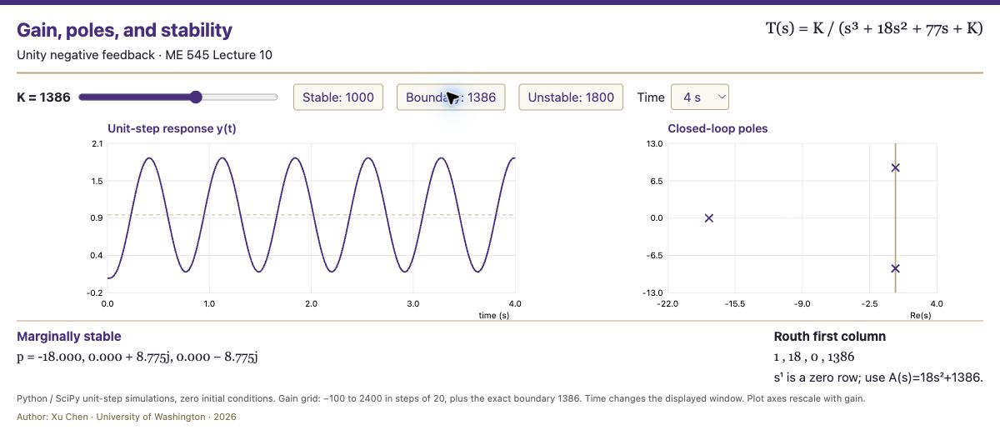

# Introduction to Controls with Python

**Xu Chen · University of Washington · ME 545**

Executable companions to *Introduction to Control Theory*: models, transfer functions, time responses, stability, and controller design. Each example connects a lecture calculation to a reproducible Python experiment.



## Start here

Use Python 3.11 or newer. From a terminal:

```bash
git clone https://github.com/xchen-me/intro-to-controls-w-python.git
cd intro-to-controls-w-python
python -m venv .venv
source .venv/bin/activate              # macOS / Linux
# .venv\Scripts\Activate.ps1          # Windows PowerShell
python -m pip install -r requirements.txt
python examples/L05_transfer_functions.py
```

The examples open Matplotlib figures. For a terminal-only run that saves plots to `out/`:

```bash
python run_all.py       # all examples
python run_all.py L10   # Lecture 10 only
```

## Lecture 10: Routh-Hurwitz stability

```bash
python examples/L10_repeated_poles.py
python examples/L10_routh_tables.py
python demos/routh_gain_app.py
```

The final command prints a local URL. Open it in your browser, then adjust **K** and the time window. Stop the server with **Ctrl+C**.

For unity negative feedback around `G(s) = K/[s(s+7)(s+11)]`, the closed-loop denominator is `s³ + 18s² + 77s + K`. Its Routh first column is `1, 18, (1386−K)/18, K`.

| Gain | Behavior |
|---|---|
| `0 < K < 1386` | Asymptotically stable |
| `K = 1386` | Simple poles at `±j√77`; sustained oscillations |
| `K > 1386` | Two right-half-plane poles |
| `K < 0` | One right-half-plane pole |
| `K = 0` | Internal characteristic polynomial has a pole at zero; the input/output transfer function degenerates |

The app uses SciPy unit-step simulations, with zero initial conditions. Python generates an offline HTML application containing a gain grid from −100 to 2400 in increments of 20, plus the exact boundary 1386. Moving the slider selects those computed simulations; it does not execute Python inside the browser. Axis limits adapt to gain.

```bash
python demos/routh_gain_app.py --build-only       # portable, offline HTML
python demos/routh_gain_app.py --gain 1386        # numerical poles and Routh column
python demos/routh_gain_app.py --port 8767        # use another port
python examples/L10_repeated_poles.py --save out/repeated-poles.png
```

The repeated-pole experiment compares numerical roots of expanded `(s+1)^12` and `(s+1)^20` against the exact repeated root −1. Small coefficient perturbations can move individual roots appreciably. Use analytical structure and a stability test to interpret numerical output; numerical root finding remains useful.

## Live repeated-pole laboratory

```bash
python demos/repeated_poles_app.py
```

Open the printed URL (port 8767), vary **n** from 2 to 40, and watch NumPy recompute the roots of the expanded polynomial `(s+1)^n`. The code, pole map, and maximum displacement from −1 update together. This is the live demonstration embedded in Lecture 10, slide 4.

This demo executes Python/NumPy in the browser using Pyodide 0.27.7 in a Web Worker. **Internet access is required on first load** to download the runtime and NumPy. The initial reference plot is labeled until Python is ready; calculations run locally in the browser. Root clusters vary with the NumPy build and platform.

```bash
python demos/repeated_poles_app.py --n 20        # run locally without a browser
python demos/repeated_poles_app.py --build-only # export the browser app
python demos/repeated_poles_app.py --port 8769  # choose another port
```

## Course examples

| Lecture | Script | Explore |
|---|---|---|
| 3 | `L03_hdd_model.py` | Hard-disk-drive model |
| 5 | `L05_dc_gain.py` | DC gain and response |
| 5 | `L05_partial_fractions.py` | Symbolic partial fractions |
| 5 | `L05_transfer_functions.py` | Transfer functions, poles, zeros |
| 6 | `L06_e_series.py` | Exponential series |
| 10 | `L10_repeated_poles.py` | Repeated roots and numerical sensitivity |
| 10 | `L10_routh_tables.py` | Symbolic arrays and special cases |
| 17 | `L17_pd_design.py` | PD design |
| 19 | `L19_pid_design.py` | PID design |

Scripts live in `examples/`; reusable Routh and plotting helpers live in `tools/`; interactive demonstrations live in `demos/`. Launch commands from the repository root. These are illustrative mathematical models, not measured experimental data.

## Check the results

```bash
python -m unittest discover -s tests -v
python run_all.py
```

The tests check the lecture polynomial factorizations, symbolic exceptional rows, the gain boundary, and simulation responses. Dependencies are NumPy, SciPy, SymPy, Matplotlib, and python-control. Optional notebooks: `python -m pip install jupyterlab ipympl`.

## Authorship and course

Author: **Xu Chen, University of Washington**. Course: **ME 545 — Introduction to Control Theory**. Code adapted from the course's Python examples, with lecture-specific explanations and demonstrations. See [Xu Chen's course website](https://faculty.washington.edu/chx/teaching/fbintro/).
